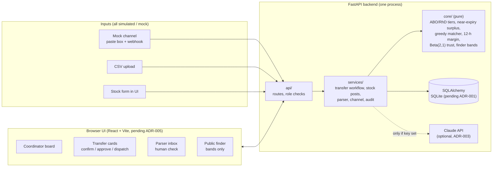
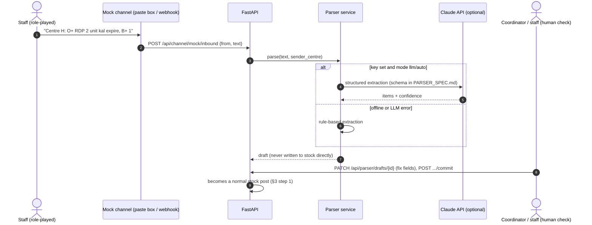

# Architecture

Status: **planned** (Checkpoint A). Stack choices marked "pending" depend on `DECISIONS.md`.

## 1. Goal and shape

One process, one database, one browser UI. That is enough for a 3-day prototype and a live or recorded demo on one
laptop. The architecture follows the deck's slide 4 flow (`out_v3/RaktSetu_TeamTrex_CodeApex3_v3.pdf`, slide 4:
ingest & parse → trust estimate → matcher → confirm & approve → dispatch & audit), with the deviations listed in
`DECISIONS.md` → "Deviations from deck".



## 2. Components and module boundaries

| Module | Responsibility | May depend on | Must not |
|---|---|---|---|
| `backend/app/core/` | Pure domain logic ported from `sim_v3/raktsetu_sim_v3.py`: `pref_list`, `surplus_near`, `apportion`, `own_offerable`, greedy matcher, 12-h margin, Beta(2,1) trust update and point estimate, staleness bucket, finder ranking and bands | Python stdlib | read the clock, do I/O, touch the DB, import the simulator, import numpy |
| `backend/app/models/` | SQLAlchemy tables (`DATA_MODEL.md`) | SQLAlchemy | contain business rules |
| `backend/app/services/` | Use cases: post stock, run matcher, transfer state machine, trust updates, parser, mock channel, audit | `core`, `models` | format HTTP responses |
| `backend/app/api/` | FastAPI routes, Pydantic schemas, demo-role dependency, error mapping | `services` | change state without a service call |
| `frontend/` | Screens: board, transfer cards, inbox, finder, role switcher, banner | API over HTTP | compute matching or trust |
| `scripts/` | Seed loader, golden fixture generator, parser evaluation | `services`, `core`; `gen_golden.py` may import the simulator **read-only** | run in the request path |

Rule of thumb: if a function could be checked against the simulator, it lives in `core/` and has a parity test.

## 3. Data flow: list → match → confirm → approve → dispatch → deliver

1. **List.** Centre staff post a stock snapshot (form, CSV, or a parsed mock-channel message after human check).
   A post replaces that centre's listed units, as a snapshot does in the simulator (`MODEL_SPEC_v3.md` §3).
   Staff also post shortfall requests (ADR-008).
2. **Match.** The coordinator runs the matcher. `core` computes each centre's offerable near-expiry surplus per
   group from its **listed** units, then runs the greedy matcher over open shortfalls in policy-tier order
   (`MATCHING_POLICY.md`). Each allocation becomes a transfer in state `suggested`, with a plain-language "why".
3. **Confirm.** The coordinator requests confirmation; the sending centre's staff answer with the number of units
   actually available. The answer updates the finder trust counters for that centre and listing-age bucket
   (α += found, β += requested − found; `MODEL_SPEC_v3.md` §5b) and corrects the listing.
   `found = 0` → `failed`. `found > 0` → `confirmed` (quantity reduced if partial).
4. **Approve.** A medical officer approves or rejects. The 12-h margin is re-checked with the current time and the
   transport estimate; approval is blocked if no unit passes.
5. **Dispatch / deliver.** Staff mark dispatched (margin checked again) and the receiving centre marks delivered.
   Delivered units are listed at the recipient with `received_via_transfer = true` and are never offered again
   (one-hop rule; `MODEL_SPEC_v3.md` §1).

Every state change writes an audit row (who, role, from → to, when, why).

### 3.1 Sequence: list → match → confirm → approve

```mermaid
sequenceDiagram
  autonumber
  actor S as Staff, sending centre (F)
  actor R as Staff, receiving centre (C)
  actor CO as Coordinator
  actor MO as Medical officer
  participant API as FastAPI
  participant CORE as core (pure)
  participant DB as Database

  S->>API: POST /api/centres/F/stock-posts (units)
  API->>DB: replace F's listed units, set last_post_at
  R->>API: POST /api/shortfalls (O+, RDP, 3)
  API->>DB: insert open shortfall
  CO->>API: POST /api/match/run {policy: strict}
  API->>DB: load listed units, shortfalls, centre params
  API->>CORE: offers = own_offerable(...), match = greedy(needs, offers, tiers)
  CORE-->>API: allocations + reasons
  API->>DB: insert transfers (suggested) + audit
  API-->>CO: suggested transfers
  CO->>API: POST /api/transfers/{id}/request-confirmation
  API->>DB: status confirm_requested + audit
  S->>API: POST /api/transfers/{id}/confirm {units_available: 3}
  API->>CORE: trust_update(α, β, found=3, requested=3); margin_ok(units, now, transport)
  API->>DB: status confirmed, trust counters, listing corrected, audit
  MO->>API: POST /api/transfers/{id}/approve
  API->>CORE: margin_ok(...) re-check
  API->>DB: status approved + audit (approver id)
  S->>API: POST /api/transfers/{id}/dispatch
  R->>API: POST /api/transfers/{id}/deliver
  API->>DB: units moved to C, received_via_transfer=true, audit
```

### 3.2 Sequence: family uses the public finder

```mermaid
sequenceDiagram
  autonumber
  actor P as Family member (public)
  participant UI as Finder page
  participant API as FastAPI
  participant CORE as core (pure)
  participant DB as Database

  P->>UI: choose group O+, component RDP
  UI->>API: GET /api/public/finder?group=O%2B&component=RDP
  API->>DB: listed units per centre, last_post_at, trust counters
  API->>CORE: bucket = staleness(now, last_post_at); p = α/(α+β); score = listed × p; band(p)
  CORE-->>API: ranked centres with band
  API-->>UI: name, area, listed count, "updated N h ago", band, phone (fictional)
  UI-->>P: High / Medium / Low likelihood + "Call before travelling"
  Note over UI,P: No percentage is shown (CLAIMS_AND_LIMITS.md)
```

### 3.3 Sequence: parsed stock message (mock channel)



## 4. What is real and what is simulated in the demo

| Part | In the demo | Label shown |
|---|---|---|
| Backend logic: matcher, tiers, trust, 12-h check, state machine, audit | **Real code**, running live, tested; core logic checked against the simulator | — |
| Database and API | **Real**, local SQLite | — |
| Centres, units, shortfalls, phone numbers | **Simulated** (fictional seed) | "Simulated data" |
| Trust history at start of demo | **Simulated** (seeded counters) | "Simulated data" |
| Staff, coordinator, medical officer | **Role-played** by the presenter through the role switcher | "Demo users · not real authentication" |
| Confirmation "call" | In-app confirm button, role-played; no phone call | "Simulated data" |
| WhatsApp / SMS messages | **Mock channel**: typed or pasted | "Mock channel" |
| LLM parsing | **Real** Claude API call if a key is set, else rule-based | "Parsed by: LLM / rules · human check required" |
| Courier, 20–24 °C box, ETA | Not modelled; transport time is a seeded estimate (ASSUMPTION) | "Estimate" |
| Outcome numbers (families, unserved %) | From the simulator only, cited, never computed by the prototype | "Simulated" + file path |
| Clinical policy | Encoded from cited sources, **not validated** | "Not clinically validated" |

## 5. Cross-cutting concerns

- **Privacy.** No patient fields anywhere in the schema. Shortfalls carry group, component and count only.
  Unit IDs are random opaque strings; no bag number, donor ID or collection-site field is stored (`DATA_MODEL.md` §4).
- **Safety gates.** A transfer cannot reach `dispatched` without an `approved` event by a user with role
  `medical_officer`. The 12-h margin is checked at approve and at dispatch.
- **Time.** All times UTC in the DB, Asia/Kolkata in the UI. `core` receives `now` as an argument so tests are
  deterministic.
- **Offline.** With no API key and no network, every demo step still works (rule-based parser).
- **Observability.** Audit log table plus an audit view; Uvicorn logs. No external telemetry.
- **Hosting.** Local laptop for Round 2. Docker / India-region cloud / GitHub Actions from the deck are deferred
  (deviation D-04).
