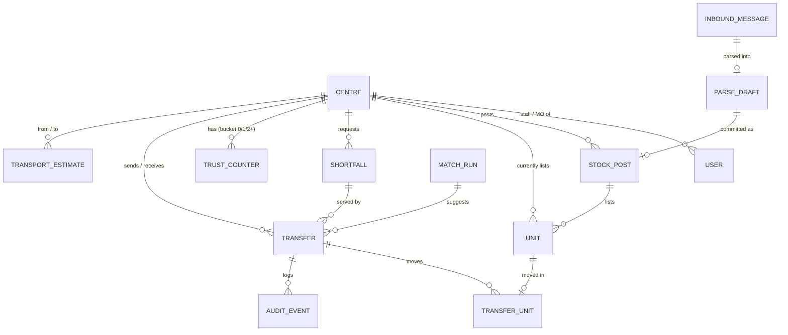
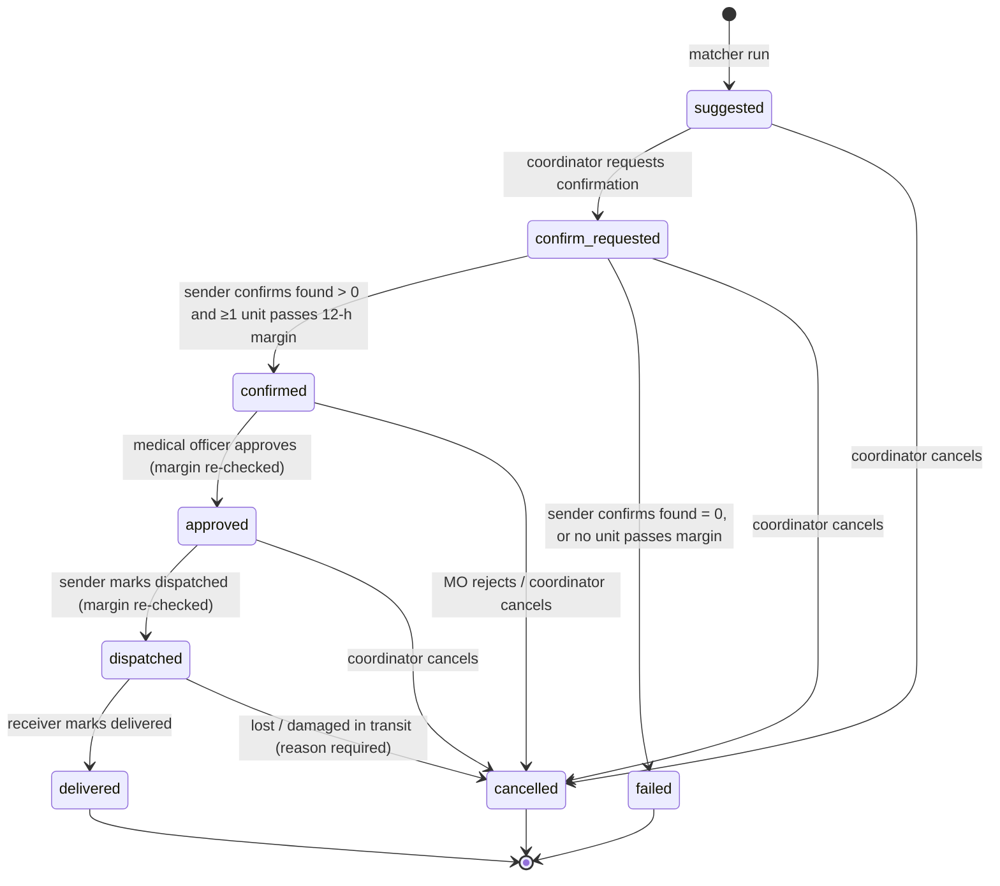

# Data model

Status: **planned** (Checkpoint A). SQLAlchemy 2.x models in `backend/app/models/`. Types are written portably so the
SQLite → Postgres swap is a `DATABASE_URL` change (ADR-001). Timestamps are timezone-aware UTC.

## 1. Entity overview

## 2. Tables

### `centre`
| Field | Type | Notes |
|---|---|---|
| id | str PK | short code, e.g. `C-A` … `C-H` |
| name | str | fictional, e.g. "Centre A · Medical college" (names from `dashboard_v3/build_dashboard_v3.py`) |
| kind | enum `hospital` / `collection` | |
| area | str | fictional locality label |
| public_phone | str | fictional, clearly fake format |
| daily_demand_mean | float | d̄ used for surplus and par (`MODEL_SPEC_v3.md` §4). Seeded from the simulator's `CENTRES` means; **simulated parameter** |
| group_demand_shares | JSON[8] | w_g; seeded from `DIST_WEST` (Agrawal et al. 2014 Table 5, via `raktsetu_sim_v3.py`) |
| last_post_at | datetime null | time of last stock post; drives listing age |
| is_simulated | bool | always `true` in this prototype |

### `user` (demo only, ADR-004)
| Field | Type | Notes |
|---|---|---|
| id | str PK | e.g. `u-coord`, `u-staff-F`, `u-mo-F` |
| display_name | str | fictional |
| role | enum `coordinator` / `centre_staff` / `medical_officer` | `public` needs no user |
| centre_id | FK centre null | null for coordinator |

### `stock_post`
| Field | Type | Notes |
|---|---|---|
| id | int PK | |
| centre_id | FK | |
| posted_at | datetime | |
| posted_by | FK user | |
| source | enum `form` / `csv` / `mock_channel` | |
| parse_draft_id | FK null | when committed from a parser draft |
| unit_count | int | |

A new post supersedes all previously listed, non-moved units of that centre (snapshot semantics,
`MODEL_SPEC_v3.md` §3). Superseded units keep their rows with `status = superseded` for audit.

### `unit` (a listed platelet unit)
| Field | Type | Notes |
|---|---|---|
| id | str PK | opaque random ID, e.g. `U-7KQ2M9` (`secrets.token_urlsafe`-based). **Not derived from any bag number** |
| centre_id | FK | centre currently listing it |
| stock_post_id | FK | post that listed it |
| component | enum `RDP` / `SDP` | random-donor vs apheresis; the simulator does not distinguish them (`MODEL_SPEC_v3.md` §7) |
| abo_rh | enum `O+ O- A+ A- B+ B- AB+ AB-` | |
| expires_at | datetime | end of last usable day; see `MATCHING_POLICY.md` §3 for the r-days mapping |
| received_via_transfer | bool | one-hop flag; true units are never offered |
| status | enum `listed` / `reserved` / `in_transit` / `delivered` / `superseded` / `not_found` | |

### `shortfall` (a need)
| Field | Type | Notes |
|---|---|---|
| id | int PK | |
| centre_id | FK | requesting centre |
| abo_rh, component | enums | |
| count_requested | int ≥ 1 | |
| count_open | int | reduced as transfers are confirmed, increased again on failure (FR-T8) |
| status | enum `open` / `covered` / `closed` | |
| created_at, created_by | | |

No patient name, age, sex, diagnosis, ward or ID. The schema has no field that could hold them (FR-L4).

### `trust_counter`
| Field | Type | Notes |
|---|---|---|
| centre_id | FK, PK part | |
| bucket | int 0 / 1 / 2, PK part | listing age in whole days, capped at 2 (`MODEL_SPEC_v3.md` §3) |
| alpha | float | starts at 2 (Beta(2,1) prior) |
| beta | float | starts at 1 |
| seeded_alpha, seeded_beta | float | portion that came from the simulated seed history, shown in the trust view |

Point estimate p = α / (α + β) (`MODEL_SPEC_v3.md` §5). This is the **finder** reliability (α_f, β_f). The
dispatch-reliability pair used only by the simulator's exploratory arm D is not implemented (non-goal).

### `transport_estimate`
| Field | Type | Notes |
|---|---|---|
| from_centre, to_centre | FK, PK | |
| minutes | int | **ASSUMPTION**: seeded; default `RAKTSETU_DEFAULT_TRANSPORT_MIN` = 90, the simulator's base assumption (`PREREGISTRATION_v3.md` §3.4) |

### `match_run`
| Field | Type | Notes |
|---|---|---|
| id | int PK | |
| run_at, run_by | | |
| policy | enum `strict` / `standard` / `relaxed` | |
| inputs_digest | str | hash of the needs and offers given to `core`, for reproducibility |
| n_suggested | int | |

### `transfer`
| Field | Type | Notes |
|---|---|---|
| id | int PK | |
| match_run_id | FK | |
| shortfall_id | FK | |
| from_centre, to_centre | FK | never equal |
| abo_rh_needed | enum | recipient group |
| abo_rh_offered | enum | donor group (differs only under standard / relaxed) |
| tier | int | position in `pref_list` (0 = identical) |
| policy | enum | copied from the run |
| anti_d_flag | bool | RhD+ unit to RhD− need (relaxed only) |
| qty_requested | int | min(need, offer) at suggestion |
| qty_confirmed | int null | |
| listing_bucket | int 0/1/2 | sender's listing age bucket at suggestion; used for the trust update |
| reason | text | the "why" shown on the card |
| status | enum, see §3 | |
| approved_by | FK user null | must be a medical officer |
| created_at, updated_at | | |

### `transfer_unit`
| transfer_id | unit_id | | Links the specific units reserved at confirmation |
|---|---|---|---|

### `audit_event`
| Field | Type | Notes |
|---|---|---|
| id | int PK | |
| at | datetime | |
| actor_id, actor_role | | |
| entity, entity_id | str | `transfer`, `stock_post`, `parse_draft`, … |
| action | str | e.g. `transition`, `create`, `commit` |
| from_state, to_state | str null | |
| note | text | |

Append-only: no update or delete route exists.

### `inbound_message` (mock channel)
| Field | Type | Notes |
|---|---|---|
| id | int PK | |
| received_at | datetime | |
| channel | enum `mock_whatsapp` / `mock_sms` / `paste` | every value starts with `mock` or is `paste` |
| sender | str | fictional number mapped to a centre |
| centre_id | FK null | resolved from sender |
| text | text | raw text as typed |

### `parse_draft`
| Field | Type | Notes |
|---|---|---|
| id | int PK | |
| inbound_message_id | FK | |
| parser | enum `llm` / `rules` | which path produced it |
| model | str null | LLM model ID when `llm` |
| payload | JSON | `PARSER_SPEC.md` §2 schema |
| needs_review_reasons | JSON list | low confidence, unknown group, missing expiry, … |
| status | enum `pending` / `committed` / `discarded` | |
| reviewed_by | FK user null | |

## 3. Transfer state machine

| From | To | Allowed role | Guard | Side effects |
|---|---|---|---|---|
| — | suggested | coordinator (via match run) | from ≠ to; tier allowed by policy; ≥ 1 unit passes margin | none on stock |
| suggested | confirm_requested | coordinator | | |
| confirm_requested | confirmed | centre_staff / MO of **sender** | 1 ≤ found ≤ requested; ≥ 1 found unit passes margin | trust α += found, β += requested − found; reserve `qty_confirmed` units; mark the missing listed units `not_found`; shortfall `count_open` reduced |
| confirm_requested | failed | centre_staff / MO of sender | found = 0, or none passes margin | trust α += found, β += requested − found (same rule as above; the simulator updates trust before the margin check, `raktsetu_sim_v3.py` `attempt()`); missing listed units marked `not_found`; shortfall reopened |
| confirmed | approved | **medical_officer** of sender (ADR-009) | margin re-check passes | `approved_by` set |
| confirmed | cancelled | MO of sender (reject) or coordinator | reason required | units back to `listed`; shortfall reopened |
| approved | dispatched | centre_staff / MO of sender | approval event exists; margin re-check passes | units `in_transit` |
| dispatched | delivered | centre_staff / MO of **receiver** | | units move to receiver, `received_via_transfer = true`, `listed` there |
| any non-terminal | cancelled | coordinator | reason required | reservations released |

All other transitions → HTTP 409. Every row writes an `audit_event`.

## 4. Privacy and identifiers

- No table has a patient field. Shortfalls hold group, component and count only.
- `unit.id` is random and generated by the platform. The centre's own bag number is never sent or stored, so a unit
  cannot be linked to a donor through this system (deck slide 4: "unit IDs not linkable to donors").
- Mock-channel `sender` values are fictional. Real phone numbers must never be entered in the demo.

## 5. Indexes

| Table | Index | Why |
|---|---|---|
| unit | (centre_id, status, abo_rh, expires_at) | offers and board per centre and group |
| unit | (status, abo_rh) | finder |
| shortfall | (status, centre_id) | open needs for the matcher |
| transfer | (status), (from_centre, status), (to_centre, status) | board columns, role inboxes |
| audit_event | (entity, entity_id, at) | audit view per transfer |
| trust_counter | PK (centre_id, bucket) | |
| parse_draft | (status) | inbox |

## 6. Seed data plan (`data/seed/`, loaded by `make seed`)

All seed content is **fictional and labelled simulated**. The seed is a hand-designed demo city, not a recorded
simulator day, so that the demo script is exact and repeatable.

- **8 centres**, mirroring the simulator's 8-centre city (`raktsetu_sim_v3.py`, `CENTRES`): 5 hospitals
  ("Centre A · Medical college" … "Centre E · Children's hospital") and 3 collection-heavy centres ("Centre F ·
  Regional centre", "Centre G · Charitable centre", "Centre H · Camp-based centre"); names from
  `dashboard_v3/build_dashboard_v3.py`. `daily_demand_mean` = the simulator's demand means
  (11.5, 5.4, 8.0, 4.0, 3.0, 2.0, 1.5, 1.0). Group shares = `DIST_WEST`.
- **Units**: ~40 listed units across centres, mostly O+ and B+ (the commonest groups in `DIST_WEST`), with expiries
  chosen so that the demo has: one clean identical-group match from a fresh, High-band donor; one match from a stale,
  Low-band donor whose confirmation comes back partial; one unit that fails the 12-h margin; one received unit that
  must not be re-offered.
- **Shortfalls**: 2–3 open shortfalls at hospital centres.
- **Trust counters**: seeded α, β per (centre, bucket) to give a mix of High / Medium / Low bands; recorded in
  `seeded_alpha/beta` and labelled "simulated history".
- **Transport estimates**: 90 min default; a few pairs set to 180 min to show the margin effect
  (both values are the simulator's assumptions: `RESULTS_v3.md` §6). **ASSUMPTION**.
- **Users**: 1 coordinator; staff + medical officer for Centres A, C, F, G, H.
- **Mock-channel samples**: 6 example messages (English and Hinglish) for the parser demo.
- **Demo clock**: the seed takes a `--now` argument (default: today 08:00 IST) so expiries are relative and the demo
  works on any day.
- `test_demo_seed_contract` asserts the exact suggestions the demo script expects, so a seed change that breaks the
  script fails a test instead of failing on stage.

## 7. Implementation notes (Stage 2, 16 Oct 2026)

- Extra columns: `transfer.component`, `transfer.transport_min` (copied from the seeded estimate at suggestion),
  `transfer.version` (optimistic concurrency), `transfer.box_validated` (recorded, not verified),
  `shortfall.identical_only`, `match_run.acknowledged_by`, `match_run.notes` (e.g. units blocked by the margin).
- New table `meta` (key/value) holds the demo-clock anchor (ADR-013).
- Unit status `delivered` is not used: on delivery the unit row moves to the receiving centre with
  `received_via_transfer = true` and `status = listed`.
- **Known limitation:** a stock post supersedes only units that were not received by transfer, so a received unit
  stays listed until it expires; there is no "issued to patient" action yet (ADR-014).
- Shortfall `count_open` drops when a transfer is suggested and is restored on failure, partial confirmation,
  margin drop, rejection or cancellation. Status: `open` (need left), `covered` (all need in active transfers),
  `closed` (nothing open, no active transfer).
